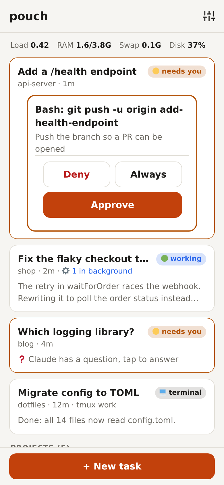
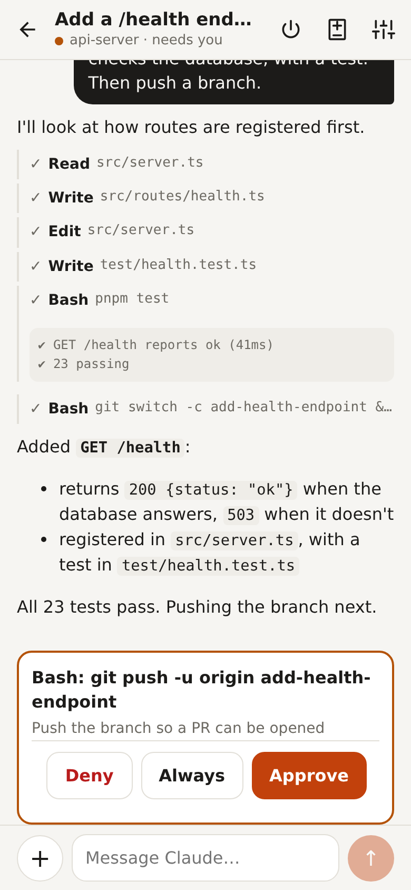
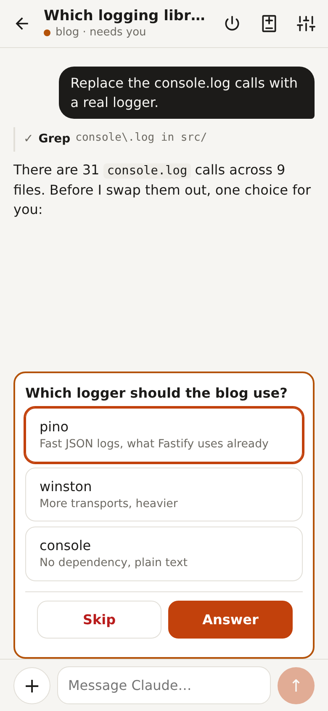
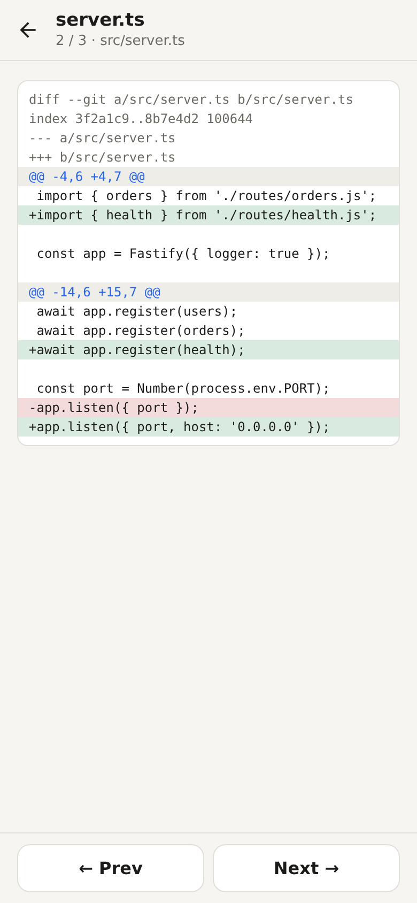

# pouch

Phone-first web UI for running and steering Claude Code sessions on your own dev box.
Start a task from your phone, approve tool calls from a notification, read the diff, and pick the
same session up later in a terminal.

<p align="center">
  <picture>
    <source media="(prefers-color-scheme: dark)" srcset="docs/screenshots/dashboard-dark.png">
    
  </picture>
  <picture>
    <source media="(prefers-color-scheme: dark)" srcset="docs/screenshots/chat-dark.png">
    
  </picture>
  <picture>
    <source media="(prefers-color-scheme: dark)" srcset="docs/screenshots/question-dark.png">
    
  </picture>
  <picture>
    <source media="(prefers-color-scheme: dark)" srcset="docs/screenshots/diff-dark.png">
    
  </picture>
</p>

A personal project, shared as is. Issues and PRs are welcome, but there's no support promise.
It's built for one person on their own machine: there are no user accounts, and everyone who can
log in can do everything.

- **Dashboard**: every session, sorted so the ones waiting for you come first.
- **Chat**: streaming replies, tool calls collapsed to one line, tap to expand output.
- **Images**: attach screenshots/photos to a message or new task (+ button, or paste). Big images are
  downscaled on the phone before upload.
- **Approvals**: Approve / Always / Deny buttons; Claude's questions become option buttons.
- **Install + push**: add to home screen; notifications when a session needs you or finishes,
  with Approve/Deny right on the notification. Skipped while the app is open in front of you.
- **Changes**: the session's uncommitted git changes, one file per screen (swipe between files);
  Edit/Write tool calls show their diff inline.
- **Terminal-aware**: Claude sessions running in a terminal (tmux) show up on the dashboard with
  busy/idle state, read from `~/.claude/sessions/<pid>.json`. Sending into a session that's open in a
  terminal is blocked unless you explicitly send anyway.
- **Projects**: clone a repo (`owner/repo` uses the box's `gh` login) or create a new folder from the
  dashboard, fast-forward pull a project from its page, or delete it. Deleting lists what would be
  lost (unpushed commits, stashes, uncommitted files, worktrees), refuses while a session is open, and
  asks you to type the name.
- **Terminals**: open a shell in a project or worktree to run commands yourself, with a key bar for
  Esc, Tab, Ctrl and arrows. It keeps running when you leave the screen; coming back replays recent
  output. Terminals live in the pouch process, so a restart or deploy ends them. They set `NO_TMUX=1`
  so a `.bashrc` that auto-attaches tmux can be told to skip it.
- **Resume**: sessions are normal Claude Code sessions. Anything started here can be picked up
  in a terminal with `claude --resume`, and terminal sessions can be resumed here.

Built on the [Claude Agent SDK](https://code.claude.com/docs/en/agent-sdk), using the machine's
Claude Code login. `ANTHROPIC_API_KEY` is dropped from the environment so a stray key doesn't
override that login; set `POUCH_USE_API_KEY=1` to bill an API key instead. Sessions run in auto
mode: a classifier approves or denies each tool call, and only the ones it can't decide ask you.

## Requirements

- Linux (macOS probably works, but is untested) with Node 22+, [pnpm](https://pnpm.io) (`npm i -g pnpm`), git, and a C++ toolchain
  (`python3`, `make`, `g++`) for `pnpm install` to build `node-pty` (`gh` for the open-PR list on project pages).
- [Claude Code](https://code.claude.com) installed and logged in (`claude`), or an
  `ANTHROPIC_API_KEY` with `POUCH_USE_API_KEY=1`.
- For the phone: HTTPS, which the PWA and push notifications need. [Tailscale](https://tailscale.com)
  with `tailscale serve` is the easy path (see below).

## Run

```sh
git clone https://github.com/berkaycubuk/pouch.git && cd pouch
pnpm install
pnpm start                # http://127.0.0.1:8787
```

Open it, paste the login token from `~/.config/pouch/token`, and start a task in a folder under
`~/Projects`. For the phone, see [Phone access](#phone-access).

Env: `POUCH_HOST`, `POUCH_PORT`, `POUCH_PROJECTS` (default `~/Projects`, where new tasks may start),
`POUCH_HOSTS` (comma-separated extra hostnames to accept; `localhost`, IPs and `*.ts.net` always work).
Requests with a foreign `Host` or a cross-site `Origin` are refused, which blocks DNS rebinding and
other sites driving the API or reading `/ws` from your browser.

## Login

Anyone who can use the API can run commands on the machine, so the API and `/ws` need a login.
On first start pouch writes a random token to `~/.config/pouch/token`. Paste it into the login
screen once per browser; it sets a cookie that lasts 400 days. Scripts can send it as
`Authorization: Bearer <token>`. Delete the file and restart to log every device out.

Once one device is logged in, others can skip the token: the login screen shows a QR code. Scan it
with the logged-in phone and tap Approve, and the new device logs in. Codes expire after 5 minutes
and work once.

Behind `tailscale serve` you can skip the token: set `POUCH_TAILSCALE_USERS` to your Tailscale
login(s), comma-separated, and requests carrying a matching `Tailscale-User-Login` header are let in.
Only do this when `tailscale serve` is the only thing proxying to pouch, since any other local
proxy could pass that header through from the outside.

## Security

pouch drives Claude Code with your account on your machine: anyone who gets in can run commands
there. Keep it on localhost behind `tailscale serve` (or another HTTPS proxy you control), don't
expose it to the internet, and keep the token private. See [SECURITY.md](SECURITY.md).

## As a service (Linux, systemd)

The units expect the checkout at `~/Projects/pouch` and `node` on the `PATH` set in
`deploy/pouch.service`; edit it if yours differ.

```sh
git clone https://github.com/berkaycubuk/pouch.git ~/Projects/pouch
cd ~/Projects/pouch && pnpm install --frozen-lockfile
cp deploy/pouch.service ~/.config/systemd/user/
systemctl --user daemon-reload
systemctl --user enable --now pouch
journalctl --user -u pouch -f
```

To update by hand: `git pull && pnpm install --frozen-lockfile && systemctl --user restart pouch`
(the restart ends pouch's live sessions; terminal sessions are unaffected).

## Auto-deploy (optional)

Meant for running pouch from your own fork, so merging a PR there deploys it. Don't point it at a
repo you don't control: it runs whatever lands on that `main`.

```sh
cp deploy/pouch-deploy.service deploy/pouch-deploy.timer ~/.config/systemd/user/
systemctl --user daemon-reload
systemctl --user enable --now pouch-deploy.timer
```

It also needs `pnpm` on the `PATH` set in `deploy/pouch-deploy.service`. The timer runs
`deploy/autodeploy.sh` every minute; if `origin/main` moved it:

1. waits while any pouch session is mid-turn or waiting on an approval (a restart would cut them
   off), up to an hour, then deploys anyway; terminal sessions are unaffected;
2. resets `~/Projects/pouch` to `origin/main`, runs `pnpm install` if the lockfile changed, then `pnpm run typecheck` and `pnpm run check:web`;
3. restarts pouch and checks it responds.

Since that checkout doubles as a working copy, deploys are skipped while it is off `main`, has
uncommitted changes to tracked files, or has local commits not on `origin/main`. Switch back to a
clean `main` and the next tick deploys.

If a check or the health check fails it rolls back to the previous commit and skips that
commit until `main` moves again. Logs: `journalctl --user -u pouch-deploy`.

## Phone access

The unit binds to localhost. Expose it to the tailnet over HTTPS (needed for the PWA and push) with
`tailscale serve --bg --https=443 http://127.0.0.1:8787`; this persists across reboots.
Only devices on the tailnet can reach it, and they still need the token unless their Tailscale
login is in `POUCH_TAILSCALE_USERS`.

Push keys and subscriptions live in `~/.config/pouch/` (override with `POUCH_DATA`).

### Without a VPN: Cloudflare Tunnel + Access

To reach pouch from any network, put it behind a [Cloudflare Tunnel](https://developers.cloudflare.com/cloudflare-one/connections/connect-networks/)
with a [Cloudflare Access](https://developers.cloudflare.com/cloudflare-one/applications/) application on the
same hostname, allowing only your email. Then set on the service:

- `POUCH_HOSTS=pouch.example.com`
- `POUCH_CF_ACCESS_TEAM=<team>.cloudflareaccess.com`
- `POUCH_CF_ACCESS_AUD=<the Access application's AUD tag>`

Every request that comes through Cloudflare (it carries `CF-Connecting-IP`) must have a valid Access
JWT, page included; without the two `POUCH_CF_ACCESS_*` variables, tunnel traffic is refused. The
token login still applies on top. Requests over `tailscale serve` or localhost are unaffected.

## Layout

- `src/server.ts`: Fastify HTTP + WebSocket API
- `src/sessions.ts`: live sessions on top of the Agent SDK (permissions, resume, idle reaping)
- `src/events.ts`: converts SDK/transcript messages into UI events
- `src/push.ts`: Web Push (VAPID keys, subscriptions)
- `src/auth.ts`: login token and the optional Tailscale-identity bypass
- `src/terminal.ts`: detects sessions open in other Claude Code processes
- `src/shells.ts`: shells in a PTY for the Terminal screen
- `src/git.ts`: read-only git queries for the Changes screen
- `web/sw.js`: service worker for notifications and their Approve/Deny actions
- `assets/`: icon sources (PNGs in `web/` are rendered from these)
- `web/`: Preact + htm frontend, no build step (vendor files served from `node_modules`)

## License

[MIT](LICENSE)
